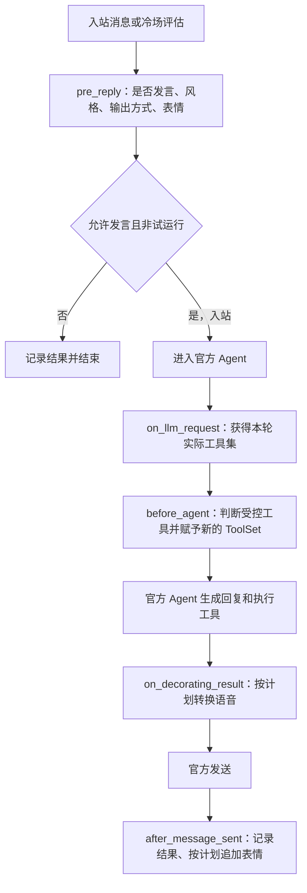

# 统一判断与能力扩展的实现方案

核对日期：2026-11-18。本仓库研究基线：`14bb895`，插件 `1.3.2`。第一阶段“统一现有判断”已在工作区实现，结构及验证记录见[统一判断引擎](decision-engine.md)。本文保留完整研究方案，工具准入、绘图、TTS 和主动 Agent 迁移尚未实现。

官方源码分别核对最低支持版本 `v4.29.4`（`61335414433db721b3f7ecc93f90deafe0a59d78`）和当日 `master`（`06fc50b43ea1c13093c91762f3b9361911362f9a`）。`master` 中存在的能力不代表已经随稳定版本发布。

## 结论

保留 `ask_decision()` 作为当前消息预判入口，将其内部改为“题目定义 → 统一解析与选择 → 结果用途”的模式。工具判断在 `on_llm_request` 中追加执行，复用同一判断引擎。第一版不引入通用工作流、动态 Python 加载或自制 Agent。[L1][U1]

新能力不一定是新的题型：“是否调用某工具”可以继续用是否题；“文字／语音／双输出”可以用选择题。真正需要扩展的是结果用途及其执行位置。

## 1. 已核实的官方接口

| 能力 | `v4.29.4` | 当日 `master` | 实现含义 |
| --- | --- | --- | --- |
| 判断题型 | Boolean、Choice、Score | 相同 | 本插件先保留 Boolean/Choice；有实际需求后再接 Score。[U1] |
| 本轮工具集 | `ProviderRequest.func_tool`、`ToolSet` | 相同机制 | 在 `on_llm_request` 中构造新集合过滤；不修改全局工具注册表。[U1] |
| 工具调用前钩子 | `on_using_llm_tool` 是通知，不能可靠取消调用 | 同样不能依赖它拦截 | 工具准入应在送入 Agent 前完成。[U1] |
| TTS 提供商 | `await context.get_using_tts_provider_async(umo)` | 存在 | 使用会话实际配置的提供商。[U2] |
| 文本转语音 | `await provider.get_audio(text)` | 存在 | 返回音频文件路径，可构造 `Record(..., text=原文)`。[U3][U4] |
| 完整主动 Agent 入口 | 无 `context.agent` | `context.agent.run_turn(...)` | 旧版不能直接换成此入口；新版入口的历史、发送语义见配套研究。[U1] |
| 绘图通用 Provider | `ProviderType` 未定义通用图像生成类型 | 本次未确认统一的绘图提供商接口 | 复用已安装绘图插件暴露的工具，不能将文字排版转图当作绘图。[U5][U6] |

判断与工具的源码证据、精确调用次序和版本比较见 [官方接口研究](decision-upstream-research.md)。

## 2. 当前行为中需要保留的差异

当前题目构造、答案解析、温度与权重集中在 `decision_engine.py`；执行结果分散在 `main.py` 与 `reply_generator.py`。[L1][L2][L3]

| 决策项 | 原行为 | 重构时的兼容要求 |
| --- | --- | --- |
| `action` | 群聊被动 `none/reply`；冷场 `none/proactive`；私聊被动固定 `reply` | 保留场景、原始概率阈值和旧 `join → reply` 兼容 |
| `target_message_id` | 动态候选，温度可用，无全局阈值 | 保留消息 ID 校验、`latest` 兜底；另测官方入站路径真正如何使用目标 |
| `use_meme` | `P(true) >= choice_threshold`，不采样 | 不随统一引擎自动改变为温度采样 |
| `meme_id` | 动态候选，温度可用，原始概率阈值 | 同时要求 `use_meme=true` 和文件可用 |
| 自定义 choice | 不使用全局阈值；按配置权重与温度选择 | 全 1 权重、零温度保留提供商原选；其他情况使用当前加权算法 |
| 自定义 boolean | 默认 `P(true) >= 0.5`；存在温度或非默认权重时采样 | 保留默认行为及选中一侧的会话提示 |

`confidence` 目前仅写日志，不等同于正在使用的概率阈值。自定义问题只产生临时会话提示，尚不能执行工具或 TTS。[L1][L2]

选择与接受必须分开：先按既有规则选中选项，再判断其原始概率是否达到该题要求；不先删除低概率选项后重新归一化，否则会改变现有抽样和回退行为。是否题的“是概率阈值”也不能直接替换成“选中一侧的概率阈值”。[L1]

## 3. 最小内部结构

只增加确有差异的两种结构，保留现有 `DecisionResult` 作为兼容外壳：

- `DecisionSpec`：本轮实际要问的题目。包含 `id`、阶段、官方 Question、选择策略、默认值和结果用途。动态候选在构造此对象时就固定，提问与解析使用同一份候选快照。
- `DecisionOutcome`：选中值、原始概率、调整后分布、处理状态和回退原因。状态至少能区分正常、缺失、非法、跳过和回退。

`DecisionResult` 新增按 ID 保存的 `outcomes`。现有 `action/use_meme/meme_id/length/custom_answers/session_hints/raw` 从统一结果投影一次，继续满足旧调用者、管理页面与历史日志；不要在两套解析器中分别维护同一答案。[L1][L2][L3]

内部 Interface 可按下列职责拆分；名称为方案示意，不是现有可调用函数：

```python
specs = build_specs(stage, state, settings, capabilities)
outcomes = await evaluate_specs(context.decision, specs, state)
result = assemble_result(outcomes, specs, scene)
```

`evaluate_specs` 批量提问并完成类型校验、选择、阈值及回退，不生成语音、不调用业务工具、不发送消息。已有 `_select_option()` 应直接复用，不另写第二套采样器。

System One 会校验整批答案，缺少任一题或概率非法可能让整次 `ask()` 抛错。统一引擎必须处理批次失败并按每题策略回退，不能声称还能取得已被 SDK 拒绝的部分答案；空题目集合直接跳过调用。[U1]

结果用途以少量已注册函数实现：临时提示、发言许可、回复目标、工具准入、输出方式和附加表情。配置只引用已支持的用途与工具 ID，不接受 Python 模块路径或任意可调用函数。

第一版仍使用 `choice/boolean`，不因为上游存在 Score 就扩大配置或网页表单。

## 4. 判断阶段与执行时机



这是两次可能的判断批次，而非每题单独请求；没有启用工具控制时，第二批不调用判断提供商。`pre_reply` 是对消息的预判，`before_agent` 必须等官方完成工具组装后才能获得准确候选集。[U1]

TTS 第一版在 `pre_reply` 选择输出方式，生成后只转换，不再问一次模型。只有确实需要根据最终正文重新选择时，再增加生成后的判断阶段。

每轮计划存在事件 extra 和现有会话运行状态中，不保存在插件级全局可变对象。现有 `_qd_hints_applied` 只表示提示已注入，不能同时拿来表示工具策略、TTS 或附图已经处理。各操作分别确保同一轮至多执行一次。[L2][L3]

## 5. 工具判断的可实现方法

推荐第一版语义为“是否允许本轮使用已配置的某工具”。通过选择题或是否题得到准入结果，再在 `on_llm_request` 收到的实际工具集合中应用；保留未配置控制的工具及官方已做的人格、权限和平台限制。[U1]

过滤方式是创建新的 `ToolSet`，保留原 Tool 对象，不原地删改共享集合，也不调用全局启停工具接口。依据工具真实 `name` 绑定配置，不根据包含“画图”“搜索”等文字猜用途。

```python
# 方案示意；放在已有 on_llm_request 的提示处理旁，使用本轮判断结果。
if req.func_tool is not None:
    req.func_tool = ToolSet(tools=[
        tool for tool in req.func_tool.tools
        if tool.name not in denied_tool_names
    ])
```

“允许”不保证调用；主 Agent 仍负责是否需要调用、参数生成和结果使用。“必须调用”需要进一步处理工具参数、强制选择、失败与重试语义，不应冒充普通是否题已经完成。第一版不自行执行 `tool.handler`，不手写 tool-call 历史。[U1]

`on_using_llm_tool` 不能作为可靠的拒绝入口：核查版本中官方忽略通知钩子的停止返回，工具开始钩子抛错也不保证停止执行。[U1]

该方案保证当前请求提交给 Agent 的工具集受到过滤；如果其他插件在之后重新注入工具，或用另一条调用路径直接执行，则不构成完整的工具沙箱。实现时需明确钩子优先级和与其他工具管理插件的组合行为。

## 6. 生图的接入方法

优先把绘图作为上一节工具控制的一种绑定：绑定已安装绘图工具的真实 ID，判断是否开放，然后交官方 Agent 生成绘图参数、调用和使用结果。这样无需新增一套图片 API 客户端或工具执行器。

如果现有绘图插件只提供指令、不注册工具，也没有稳定公开调用接口，就不能仅凭配置接入。应先确定具体绘图插件，再为其公开接口写一个小 Adapter，并明确到底由谁发送图片；不能两边都发送。

AstrBot 的 `context.html_renderer`、`result.use_t2i_` 和结果装饰阶段的“文本转图片”用于排版渲染回复，不是生成画作，不能用于替代绘图接口。[U5][U6]

“允许绘图”和“已成功出图”应分别记录。判断返回 true 不代表已经产生图片；失败仍可让官方 Agent 处理工具错误，不伪造成功附件。

## 7. TTS 的接入方法与限制

官方提供商接口足够使用：

```python
provider = await context.get_using_tts_provider_async(umo)
audio_path = await provider.get_audio(text)
# 在校验提供商、返回路径和异常后，构造 Record(file=audio_path, text=text)。
```

提供商选择支持会话偏好，`get_audio()` 返回音频文件路径。`Record.text` 可保留原回复文字，官方 RespondStage 会将 Record 单独发送。[U2][U3][U4][U7]

推荐输出题为 `text / voice / text_voice`，默认 `text`。没有可用提供商时，语音选项不进入候选；转换超时、抛错、返回空路径或文件不可用时保留原文字，不能先删文字再调用 TTS。

当前官方 TTS 在 `on_decorating_result` 之后自动转换 Plain：`v4.29.4` 依赖自动 TTS 配置、会话状态、触发概率和提供商；`master` 调整了会话配置读取，但仍未在此路径提供单事件强制开关。[U8][U9]

因此推荐第一版要求：用户明确选择由本插件控制语音，并关闭相应配置档的官方自动 TTS，但保留 TTS 提供商配置。若检测到官方自动 TTS 仍开启，应显示冲突并阻止启用本插件的独立语音模式，不能声称模型选 text 就能禁止官方转语音。

不采用临时修改全局 TTS 配置、持久化切换会话 TTS 开关，或把 LLM_RESULT 改为普通消息来绕过官方 TTS。这些做法会影响其他会话或其他结果处理。[U8][U9]

入站非流式回复：在现有 `on_decorating_result` 中按计划替换／追加 Record，然后继续官方发送。保留 Reply、At、Image 等无关消息段，不在钩子中手动重复发送。需明确首版转换的是模型回复正文，官方在钩子后追加的回复前缀不包含在合成文本中。[U8]

冷场自行生成路径：调用同一文字转语音函数，随后仍由自行发送逻辑发出，不能假设它会运行官方装饰阶段。首版建议先支持入站非流式语音，再单独接入冷场发送分支。

还需改两处已有假设：`main.py` 发送后当前只从 Plain 收集机器人文字，语音输出需使用保留的正文或 Record.text 更新缓冲；表情追加应依赖“主回复成功”，而非只判断是否发出了文字。[L2][L3]

流式输出不能直接沿用此方案：官方结果装饰阶段跳过流式过程，结束事件也不会再运行同一套转换。第一版应标明不支持流式 TTS 决策，不能一边流式发送文字一边在完成后补发整段语音。[U8]

## 8. 冷场主动回复的版本路线

保留 `>=4.29.4,<5` 时，可以先统一判断模型和配置，继续沿用当前冷场 `llm_generate` 路径；该路径不支持新的工具／绘图控制时，应跳过相关题并写明能力不可用。`tool_loop_agent()` 本身仍不能等同于完整官方主 Agent 流水线。[L3][U1]

当目标稳定版本包含新的 AgentService 后，可评估用 `context.agent.run_turn(umo=..., input_message=..., send_to_user=True)` 处理冷场，由官方管理会话历史和投递，再通过 metadata 关联本插件计划。不能仅凭 `master` 有方法就直接提高版本下限到一个未核实的版本号。[U1]

新版 run_turn 并不意味着所有现有消息钩子自动一模一样生效；需逐项验证工具策略、输出转换、统计和表情追加。`send_to_user=False` 也不是无副作用试运行，不能替代本插件当前 dry_run 的提前退出。[U1]

## 9. 文件改动范围与实施顺序

| 文件 | 预计改动 |
| --- | --- |
| `models.py` | 增加 DecisionSpec/Outcome；DecisionResult 保存统一结果并保留兼容字段 |
| `decision_engine.py` | 构造题目与统一评估；保留原选择策略；支持不同阶段批量评估 |
| `config_util.py`、`_conf_schema.json` | 将旧自定义问题映射到提示用途；增加实际启用的新能力配置与严格校验 |
| `main.py` | before_agent 接入真实工具集；输出转换；事件生命周期与降级处理 |
| `reply_generator.py` | 复用提示和附图；抽出非流式 TTS 转换并记录实际正文／结果 |
| `web_api.py`、`views/meme_manager/*` | 保存结果用途与目标工具；展示缺失能力、冲突及统一日志，保留旧配置 |
| `tests/*`、README | 原行为兼容、能力执行和失败回退测试；说明版本与流式支持范围 |

分三次可独立验证的改动：

1. **统一现有判断，不增加能力。** 保留旧配置、默认题和日志读取，验证动态候选、私聊默认回复、所有采样／阈值及表情依赖。
2. **加入工具准入，绘图作为工具用途。** 在官方 on_llm_request 获取实际工具；新增题目可以在网页配置，但执行参数继续由官方 Agent 管理。
3. **加入非流式 TTS。** 先处理入站，验证官方自动 TTS 冲突和失败回退，再接冷场；完整主动 Agent 迁移另行按稳定版本安排。

新能力批次失败时，应继续已允许的普通文字回复，受控工具回退为不开放、语音回退文字。原主判断失败仍保留“私聊放行官方、群聊沉默”。注意私聊旧降级分支目前不挂载事件决策：新增能力默认计划需单独传递，不能挂上带 error 的旧 DecisionResult 后又因 `should_speak()` 为 false 把私聊回复阻断。[L1][L2]

## 10. 验证重点

- 旧配置往返不丢字段；只读历史日志不要求迁移；默认 length 和 join 兼容。
- 同一动态候选快照用于提问与解析；工具／图片在执行前失效时正确回退。
- 零温度、默认权重、零权重、极低温度、非法概率、阈值与抽样顺序、boolean 边界保持原行为。
- `action=none` 或 dry_run 时，不运行主模型、新能力提供商和任何发送；能力判断也不重复触发。
- 工具过滤保留共享集合原样、不扩大官方准入范围、不影响并发的另一会话；禁止工具不进入提交的工具集；工具结果和历史仍由官方产生。
- TTS 为三种模式分别验证成功、无提供商、超时、空路径和异常；不丢原文、不重复转语音、不误转工具中间输出。
- 语音后机器人缓冲、冷却、主动次数和表情追加按主回复实际结果更新；部分发送失败与钩子重入不重复附图。
- 使用实际 `v4.29.4` 和拟支持的新稳定版本做安装、非流式、流式降级以及至少两会话并发集成验证。现有接口替身测试不足以证明上游钩子顺序。

## 来源

[L1] 本仓库 [decision_engine.py](../decision_engine.py)、[models.py](../models.py)、[config_util.py](../config_util.py)，基线 `14bb895`。

[L2] 本仓库 [main.py](../main.py)、[official_handoff.py](../official_handoff.py)、[session_store.py](../session_store.py)，基线 `14bb895`。

[L3] 本仓库 [reply_generator.py](../reply_generator.py)、[official_segment.py](../official_segment.py)，基线 `14bb895`。

[U1] [配套官方接口研究](decision-upstream-research.md)，包含 DecisionService、ToolSet、主 Agent 构建、工具钩子及新 AgentService 的固定源码链接。

[U2] 官方 v4.29.4 [Context.get_using_tts_provider_async](https://github.com/AstrBotDevs/AstrBot/blob/61335414433db721b3f7ecc93f90deafe0a59d78/astrbot/core/star/context.py#L581-L602)。

[U3] 官方 v4.29.4 [TTSProvider.get_audio](https://github.com/AstrBotDevs/AstrBot/blob/61335414433db721b3f7ecc93f90deafe0a59d78/astrbot/core/provider/provider.py#L243-L263)。

[U4] 官方 v4.29.4 [Record 与 text 字段](https://github.com/AstrBotDevs/AstrBot/blob/61335414433db721b3f7ecc93f90deafe0a59d78/astrbot/core/message/components.py#L270-L295)。

[U5] 官方 v4.29.4 [ProviderType](https://github.com/AstrBotDevs/AstrBot/blob/61335414433db721b3f7ecc93f90deafe0a59d78/astrbot/core/provider/entities.py#L34-L40)、[Context.html_renderer](https://github.com/AstrBotDevs/AstrBot/blob/61335414433db721b3f7ecc93f90deafe0a59d78/astrbot/core/star/context.py#L132-L137)。

[U6] 官方 v4.29.4 [排版转图分支](https://github.com/AstrBotDevs/AstrBot/blob/61335414433db721b3f7ecc93f90deafe0a59d78/astrbot/core/pipeline/result_decorate/stage.py#L368-L412)。

[U7] 官方 v4.29.4 [RespondStage 单独发送 Record](https://github.com/AstrBotDevs/AstrBot/blob/61335414433db721b3f7ecc93f90deafe0a59d78/astrbot/core/pipeline/respond/stage.py#L337-L388)。

[U8] 官方 v4.29.4 [装饰钩子、流式处理](https://github.com/AstrBotDevs/AstrBot/blob/61335414433db721b3f7ecc93f90deafe0a59d78/astrbot/core/pipeline/result_decorate/stage.py#L126-L203)、[官方 TTS 触发与失败回退](https://github.com/AstrBotDevs/AstrBot/blob/61335414433db721b3f7ecc93f90deafe0a59d78/astrbot/core/pipeline/result_decorate/stage.py#L269-L366)、[持久化会话 TTS 状态](https://github.com/AstrBotDevs/AstrBot/blob/61335414433db721b3f7ecc93f90deafe0a59d78/astrbot/core/star/session_llm_manager.py#L86-L155)。

[U9] 当日 master [TTS 触发条件](https://github.com/AstrBotDevs/AstrBot/blob/06fc50b43ea1c13093c91762f3b9361911362f9a/astrbot/core/pipeline/result_decorate/stage.py#L268-L284)、[Context 与新 AgentService](https://github.com/AstrBotDevs/AstrBot/blob/06fc50b43ea1c13093c91762f3b9361911362f9a/astrbot/core/star/context.py#L180-L195)。
